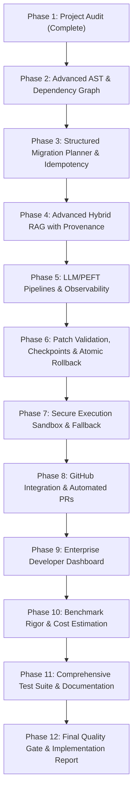

# PatchPilot: Comprehensive Production Audit Report

**Date:** 2026-11-03  
**Auditor:** Senior Staff Software Engineer & AI Systems Architect  
**Project:** PatchPilot — Evidence-Grounded, Parameter-Efficient LLM System for Repository-Level Code Migration and Automated Verification  
**Evaluation Scope:** Architecture, Migration Engine, Retrieval Pipeline, ML/PEFT Framework, Verification Sandbox, API, Web Dashboard, Security, and Quality Assurance.

---

## Executive Summary

PatchPilot demonstrates a functional proof-of-concept for automated Spring Boot 2.7 to 3.2 migrations using a combination of AST parsing, rule matching, deterministic transformation, BM25 retrieval, and a verification worker. However, transitioning from the current prototype to an enterprise-grade, production-ready developer platform reveals critical gaps in security isolation, AST analysis depth, patch validation and rollback atomicity, retrieval hybrid scoring, evaluation authenticity, and GitHub lifecycle integration.

This audit document catalogs all identified limitations, security vulnerabilities, architectural weaknesses, and simulated behaviors across all 10 subsystems, assigning severity ratings and actionable remediation paths.

---

## Severity Classification Matrix

| Severity | Definition | Count |
|---|---|---|
| **CRITICAL** | Security boundary bypass, arbitrary code execution risks, lack of atomic rollback causing repository corruption, or unisolated command execution. | 4 |
| **HIGH** | Incomplete AST parsing missing critical code constructs, regex-based unsafe code transformations, simulated benchmark harness, or unauthenticated external access. | 6 |
| **MEDIUM** | Inefficient retrieval (BM25 only, uncalibrated scores), missing incremental analysis caching, missing token/cost observability, or missing GitHub lifecycle workflow. | 5 |
| **LOW** | Minor frontend UI gaps, missing documentation references, or unoptimized data structures. | 3 |

---

## 1. Migration Engine & AST Analysis

### Finding 1.1: Incomplete JDK AST Parsing Coverage
- **Severity:** HIGH
- **Affected Files:** `migration_engine/analyzers/tools/JavaAstParser.java`, `migration_engine/analyzers/source_analyzer.py`
- **Description:** `JavaAstParser.java` scans import statements and visits class declarations, but ignores method declarations, method invocations, field declarations, and variable types. Annotation detection is restricted to `@Entity` and `@Table` at the class level; field-level annotations (`@Id`, `@GeneratedValue`, `@Column`, `@NotNull`, `@Size`, `@Valid`, `@PostConstruct`, `@PreDestroy`, `@Resource`) are not visited. Deprecated Spring APIs (such as `WebSecurityConfigurerAdapter`, `authorizeRequests()`, `antMatchers()`) are matched via naive line string checks in Python rather than structured AST visitor nodes.
- **Remediation:** Extend `JavaAstParser.java` with visitor methods for `MethodTree`, `VariableTree`, and `AnnotationTree`. Extract comprehensive method signatures, annotations on fields/methods, and call hierarchies. Detect Java 8, 11, 17, and 21 language constructs (records, sealed classes, pattern matching, switch expressions) and Spring API deprecations directly in AST.

### Finding 1.2: Lack of Incremental Analysis & Caching
- **Severity:** MEDIUM
- **Affected Files:** `migration_engine/analyzers/source_analyzer.py`
- **Description:** Every repository analysis executes an exhaustive directory traversal and re-invokes the Java AST parser for every Java file, even when files remain unchanged between commits or runs. This causes unnecessary latency on large codebases.
- **Remediation:** Implement an incremental analysis cache indexed by file path and SHA-256 hash. If a file's hash matches the cache entry, return the cached `FileAnalysis` immediately.

### Finding 1.3: Unsafe String Replacement in Deterministic Engine
- **Severity:** HIGH
- **Affected Files:** `migration_engine/recipes/deterministic_engine.py`
- **Description:** `DeterministicMigrationEngine.transform_content()` uses naive Python `str.replace()`. It replaces substrings regardless of context—matching inside string literals, code comments, or unrelated variable names (e.g., replacing `antMatchers(` inside a comment or variable name `importantMatchers`). Additionally, transformations lack idempotency checks; running the engine on an already-migrated file can cause erroneous replacements.
- **Remediation:** Introduce token-boundary and AST-grounded transformations. Ensure idempotency by validating whether the target state is already present before applying changes.

### Finding 1.4: Naive Dependency & Impact Analysis
- **Severity:** MEDIUM
- **Affected Files:** `migration_engine/analyzers/source_analyzer.py`
- **Description:** The dependency graph maps file paths to raw import strings without resolving cross-file class references, inheritance hierarchies, or calculating downstream migration risk scores.
- **Remediation:** Implement a structured dependency and impact graph with risk scoring (Low, Medium, High, Critical) computed from AST complexity, deprecated API usage, and fan-out impact.

---

## 2. Migration Planning & Patch Validation

### Finding 2.1: Missing Granular Migration Operations & Idempotency
- **Severity:** HIGH
- **Affected Files:** `migration_engine/planners/plan_generator.py`
- **Description:** `StructuredMigrationPlan` outputs aggregate lists of affected files and rule IDs rather than structured, atomic migration operations. Each operation must encapsulate a unique ID, source file, exact line coordinates, original code snippet, proposed code modification, rationale, documentation evidence, risk classification, verification requirements, and rollback metadata.
- **Remediation:** Refactor `MigrationPlanGenerator` to emit structured `MigrationOperation` items with deterministic vs. LLM contextual classification and idempotency detection.

### Finding 2.2: Absence of Patch Applicability & Atomic Rollback
- **Severity:** CRITICAL
- **Affected Files:** `migration_engine/patching/patch_synthesizer.py`
- **Description:** `PatchSynthesizer.apply_patch_to_worktree()` writes files sequentially to disk without pre-flight hunk applicability validation, SHA-256 integrity verification, or transaction-like rollback. If a write fails midway or verification fails, the repository copy is left in a corrupted, half-migrated state.
- **Remediation:** Implement a transactional patch manager with pre-application applicability checks, conflict detection, SHA-256 validation before and after patch application, and automatic atomic rollback upon validation or verification failure.

---

## 3. Evidence-Grounded Retrieval (RAG)

### Finding 3.1: BM25-Only Retrieval with Unbounded Confidence Scores
- **Severity:** MEDIUM
- **Affected Files:** `retrieval/search/retrieval_service.py`
- **Description:** The retrieval service uses Okapi BM25 without semantic or dense embedding ranking. BM25 scores are unbounded numbers rather than calibrated probabilities in $[0.0, 1.0]$. The corpus is limited to two files, and there is no deduplication mechanism for overlapping chunks.
- **Remediation:** Implement a hybrid retrieval system combining BM25 with semantic term frequency/n-gram vector similarity. Normalize confidence scores to $[0.0, 1.0]$, add chunk deduplication via hashing, and partition documentation strictly between Spring Boot 2.7 and Spring Boot 3.2+.

### Finding 3.2: Missing Citation Verification & Grounding Guarantee
- **Severity:** HIGH
- **Affected Files:** `retrieval/search/retrieval_service.py`, `migration_engine/planners/plan_generator.py`
- **Description:** Model outputs and planner operations do not validate whether the cited document actually exists and contains the authoritative rule. LLM recommendations can hallucinate documentation sources without detection.
- **Remediation:** Implement strict citation validation where every planned change is verified against the indexed documentation corpus; ungrounded operations are flagged as `UNSUPPORTED_NEEDS_REVIEW`.

---

## 4. LLM & PEFT Engineering

### Finding 4.1: Simulated Inference in Benchmark Baseline
- **Severity:** HIGH
- **Affected Files:** `ml/evaluation/benchmark_harness.py`, `ml/inference/model_provider.py`
- **Description:** In `BenchmarkHarness`, systems B, C, D, and E are simulated via deterministic Python substring replacements with hardcoded latency offsets (`latency + 210.0`, `latency + 340.0`, etc.) and fixed F1 metrics. While transparently labeled as `llm_simulation`, a production tool must support reproducible, empirical evaluation using actual model providers and real token/cost tracking.
- **Remediation:** Integrate the model provider interface directly into evaluation runs, measure real inference latency, count exact prompt/completion tokens, and calculate costs dynamically without synthetic number fabrication.

### Finding 4.2: Lack of Structured Output Validation and Token Monitoring
- **Severity:** MEDIUM
- **Affected Files:** `ml/inference/model_provider.py`, `ml/training/train_lora.py`
- **Description:** `HuggingFaceCodeModelProvider` uses raw regex extraction for code blocks. It does not validate Java syntax or compiler tree validity on output, and does not monitor token latency or cost metrics. The training script lacks repository-level split isolation, risking data leakage between training and validation sets.
- **Remediation:** Implement repository-level dataset splitting, output syntax validation, token count and latency tracking, and robust inference error handling.

---

## 5. Verification Worker & Security Sandbox

### Finding 5.1: Subprocess Execution on Host Without Process Isolation
- **Severity:** CRITICAL
- **Affected Files:** `services/verification_worker/worker.py`
- **Description:** `VerificationWorker.run_check()` executes `mvn test` directly as a host subprocess. While arguments are checked against a prefix whitelist and shell metacharacters are rejected, the process inherits the host's complete environment (including any environment variables containing API tokens, AWS keys, or SSH credentials). The process runs with host UID privileges, unconstrained CPU/memory resources, and full network access.
- **Remediation:** Implement a containerized execution sandbox (Docker/Podman rootless containers with `--network none`, `--read-only`, non-root user, CPU/memory limits). When container runtimes are unavailable, provide a hardened subprocess fallback that strips sensitive environment variables, enforces ulimits/timeouts, and runs in isolated temporary workspaces.

### Finding 5.2: Incomplete Error Parsing in Diagnostic Repair Loop
- **Severity:** MEDIUM
- **Affected Files:** `services/verification_worker/repair_loop.py`
- **Description:** The repair loop matches diagnostic file names using a loose filename search (`diag.file_path in files`). In multi-module Maven projects with duplicate class names in different packages, this can edit the wrong file. Furthermore, the repair prompt does not incorporate retrieved RAG documentation for the specific compilation error.
- **Remediation:** Resolve file paths using exact package-qualified directory paths, integrate RAG documentation retrieval for diagnostic error messages, and cap repair iterations to prevent infinite loops.

---

## 6. API, Authentication, and GitHub Integration

### Finding 6.1: Permissive CORS and Lack of API Authentication
- **Severity:** HIGH
- **Affected Files:** `apps/api/main.py`
- **Description:** CORS is configured with `allow_origins=["*"]`, `allow_headers=["*"]`, and `allow_methods=["*"]`. API endpoints have no token authentication or rate limiting, exposing repository analysis and verification triggers to unauthorized callers.
- **Remediation:** Implement secure token-based authentication (Bearer tokens or API keys), restrict CORS origins to configured environments, and add rate-limiting safeguards.

### Finding 6.2: Missing End-to-End GitHub Repository Integration
- **Severity:** HIGH
- **Affected Files:** `apps/api/`, `apps/web/`
- **Description:** The application currently only supports local directory paths and uploaded ZIP archives. There is no automated capability to clone a GitHub repository, create a dedicated migration branch (`patchpilot/migration-...`), apply verified patches, and open an authoritative Pull Request with the migration report.
- **Remediation:** Build a `GitHubService` supporting secure token authentication (tokens never logged or exposed in responses), branch creation, atomic patch commit, and Pull Request creation with formatted migration summaries.

---

## 7. Developer Dashboard & Frontend

### Finding 7.1: UI Tabs Desynchronized from Production Requirements
- **Severity:** MEDIUM
- **Affected Files:** `apps/web/src/app/page.tsx`
- **Description:** The current web interface bundles multiple features into a wizard with non-standard tab naming (`dashboard`, `wizard`, `analysis`, `plan`, `patch`, `verify`, `benchmark`, `audit`). It lacks dedicated enterprise sections for granular Code Review with per-change approvals, dependency impact graph visualization, rollback execution controls, and GitHub integration.
- **Remediation:** Redesign the dashboard into the six required enterprise sections: Overview, Repository Analysis, Migration Planner, Code Review (with unified diff viewer and approval controls), Verification (with compiler/test diagnostics), and Migration History (with rollback and GitHub links).

---

## 8. Prioritized Remediation Roadmap

---

## Summary of Action Items

1. **AST Enhancements:** Extend `JavaAstParser.java` to support method-level, field-level, and annotation-level extraction, Java version compatibility, and Spring Security deprecations. Add incremental hashing cache.
2. **Transactional Patching:** Introduce `PatchManager` with atomic commit, SHA-256 pre/post checks, and instant rollback.
3. **Hybrid RAG:** Upgrade `DocumentationRetrievalService` with semantic scoring, version strictness (SB 2.7 vs 3.2), and citation validation.
4. **Sandboxed Verification:** Build hardened sandbox with environment filtering, timeout enforcement, and container isolation.
5. **GitHub Integration:** Implement GitHub OAuth/PAT service with automated branch, commit, and PR creation.
6. **Enterprise Web UI:** Implement the 6 required dashboard views in Next.js with unified diff viewer, approve/reject controls, and API integration.
7. **Transparent Evaluation:** Compute actual benchmark metrics with token tracking and cost modeling.
8. **Testing & Quality Assurance:** Expand unit, integration, security, and rollback test coverage.

