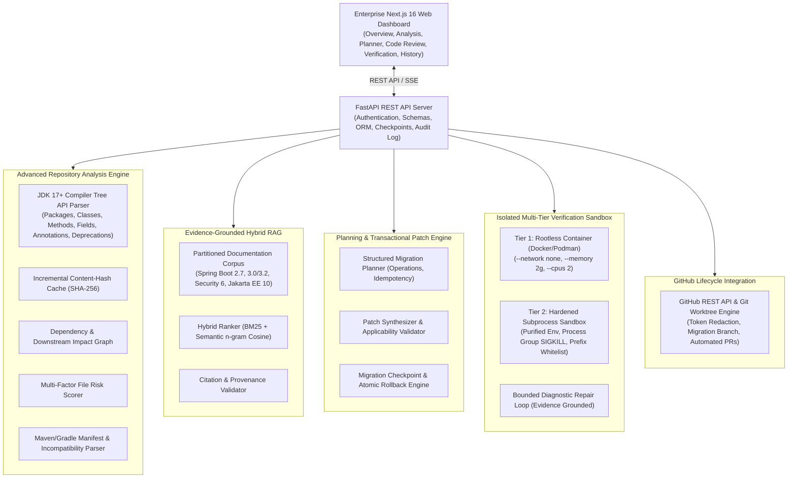

# PatchPilot Architecture Documentation

## 1. System Overview
PatchPilot is an enterprise-grade, evidence-grounded software migration system that automates the transition of Java Spring Boot 2.x repositories to Spring Boot 3.x. The architecture integrates deep compiler AST analysis, version-aware hybrid documentation retrieval, structured migration planning, transactional patch synthesis, isolated verification execution, bounded diagnostic self-repair, GitHub automation, and reproducible empirical evaluation.

## 2. Component Diagram

## 3. Subsystem Descriptions

### 3.1 Advanced Repository Analysis Engine (`migration_engine/analyzers`)
- **JDK 17+ Compiler Tree AST Parser (`JavaAstParser.java`)**: Utilizes the official Java Compiler Tree API (`JavacTask`, `Trees`, `SourcePositions`) to parse modern Java 17+ constructs (records, switch expressions, text blocks, pattern matching) and inspect packages, imports, class hierarchies, method signatures, field annotations, and deprecated Spring APIs.
- **Incremental Analysis Cache**: Caches file analysis outputs indexed by relative file path and SHA-256 content hash, bypassing redundant parsing for unchanged files.
- **Dependency & Downstream Impact Graph**: Tracks cross-file class references and generates a structured directed graph linking upstream dependencies to downstream impacted files.
- **File-Level Risk Scoring**: Calculates multi-factor migration risk scores ($0.0$ to $100.0$) and categorizes files into LOW, MEDIUM, HIGH, or CRITICAL tiers based on AST complexity and deprecated API usage.
- **Manifest Parser**: Analyzes `pom.xml` and `build.gradle` to extract compiler baselines, detect incompatible Spring Boot 2.x starter dependencies, and verify JDK 17 compatibility.

### 3.2 Evidence-Grounded Hybrid RAG (`retrieval/`)
- **Partitioned Documentation Corpus**: Strictly partitions Spring Boot 2.7 baseline documentation from Spring Boot 3.0/3.2+, Spring Security 6, and Jakarta EE 10 reference guides.
- **Hybrid Retrieval Ranker**: Fuses lexical Okapi BM25 scores with semantic character n-gram cosine similarities, normalizing scores into calibrated confidence probabilities $[0.0, 1.0]$.
- **Chunk Deduplication**: Hashes chunk contents via SHA-256 to ensure zero duplicate chunks in the indexed corpus.
- **Citation Provenance & Validation**: Verifies that generated citations exist in the official corpus and match target version constraints.

### 3.3 Structured Migration Planner & Transactional Patch Engine (`migration_engine/planners`, `migration_engine/patching`)
- **Structured Migration Operations**: Each planned change is represented as an atomic `MigrationOperation` containing unique ID, source coordinates, original snippet, proposed code modification, deterministic vs. LLM contextual classification, documentation evidence, risk score, verification requirements, and rollback metadata.
- **Idempotency Detection**: Recognizes already-migrated patterns as no-ops to prevent redundant or destructive changes upon repeated execution.
- **Pre-Flight Patch Applicability Validation**: Validates that patch lines and boundaries match the target file state before disk modification, rejecting conflict markers.
- **Transactional Checkpoint & Atomic Rollback**: Captures pre-modification snapshots and SHA-256 hashes in a `MigrationCheckpoint`. If any file write or validation fails, an instant, atomic rollback restores all files.

### 3.4 Multi-Tier Execution Sandbox & Bounded Diagnostic Repair (`services/verification_worker`)
- **Tier 1 (Rootless Container)**: When a container runtime is active, executes verification builds inside a disposable container with `--network none`, `--memory 2048m`, and `--cpus 2.0`.
- **Tier 2 (Hardened Subprocess Sandbox)**: Transparent fallback executing builds in isolated temporary worktrees with:
  - Whitelist-only environment variable filtering (purging all cloud tokens, API keys, and SSH credentials).
  - Process group isolation (`start_new_session=True` with `os.killpg` on timeout/cancellation).
  - Command prefix whitelist (`mvn test-compile`, `mvn test`, `gradle test`) and dangerous flag blacklist (`-Dexec.executable`, `-DforkCount=0`, etc.).
- **Bounded Diagnostic Repair Loop**: Captures compiler and test errors, classifies failure modes, queries documentation retrieval for the error snippet, synthesizes minimal repair patches, and re-verifies with bounded iterations (default 2) to eliminate infinite repair loops.

### 3.5 GitHub Lifecycle Integration (`services/github_service.py`)
- **Secure Token Management**: Authenticates using GitHub Personal Access Tokens or GitHub App tokens, with automatic token redaction across all logs, error messages, and git remotes.
- **Automated Workflow**: Clones repository, generates dedicated migration branch (`patchpilot/migration-sb3-<timestamp>`), applies verified patches, executes sandbox checks, and opens an authoritative Pull Request with a formatted Markdown migration report and verification status badge.

### 3.6 Evaluation & Benchmark Harness (`ml/evaluation`)
Empirically assesses and compares 6 systems against an explicit manifest of $N=10$ held-out migration tasks with zero repository leakage between train and test splits, generating reproducible JSON and CSV reports with token and cost observability.
