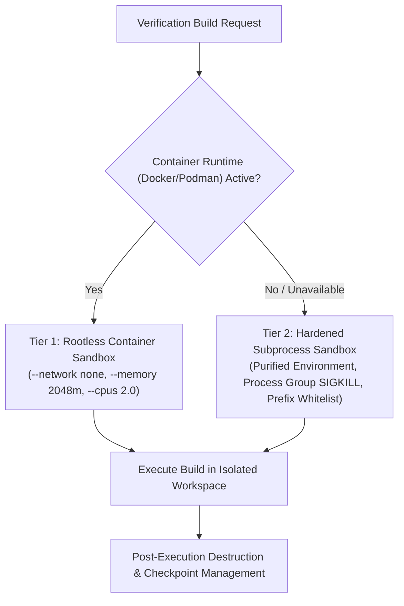

# Security Architecture & Execution Sandbox Boundary

## 1. Threat Model & Untrusted Inputs
PatchPilot treats all user-provided code, uploaded archive files, repository comments, third-party Maven/Gradle dependencies, and model-generated commands as **untrusted inputs**.

### Primary Threat Vectors Addressed:
1. **Archive Path Traversal (Zip Slip)**: Malicious archives containing `../` paths intended to overwrite system binaries or sensitive configs.
2. **Arbitrary Command Execution / Shell Injection**: Attackers attempting to inject shell metacharacters (`;`, `&`, `|`, `` ` ``, `$()`) into build arguments.
3. **Sandbox Escape & Unsafe Worktrees**: Modifications targeting paths outside the temporary isolated worktree.
4. **Denial of Service (Zip Bombs & Excessive Recursion)**: Uncompressed archives or infinite file count floods.
5. **Environment Credential Exfiltration**: Malicious Maven build scripts or plugins attempting to read environment variables (e.g., `GITHUB_TOKEN`, `AWS_SECRET_ACCESS_KEY`, `OPENAI_API_KEY`).
6. **Orphaned Process Spawning**: Build tools launching detached background daemons to persist beyond task completion.
7. **Prompt Injection through Code Comments**: Malicious repository comments attempting to override system migration constraints.

---

## 2. Multi-Tier Execution Sandbox Architecture

PatchPilot employs a dual-tier execution sandbox model:

### Tier 1: Container Sandbox (Rootless Docker/Podman)
When a container daemon is active, builds are executed in a disposable container:
- **Network Isolation**: `--network none` restricts all outbound sockets.
- **Resource Constraints**: `--memory 2048m --cpus 2.0` guards against compute and memory exhaustion.
- **Disposable Lifecycle**: Containers are created with `--rm` and destroyed immediately upon task completion.

### Tier 2: Hardened Subprocess Sandbox (Transparent Fallback)
When a container daemon is not active on the host machine, the system falls back to a hardened subprocess sandbox:
- **Environment Variable Purification**:
  - The worker strips all sensitive environment variables before spawning any process.
  - Purged keys include `GITHUB_TOKEN`, `AWS_ACCESS_KEY_ID`, `AWS_SECRET_ACCESS_KEY`, `OPENAI_API_KEY`, `ANTHROPIC_API_KEY`, `HF_TOKEN`, `SSH_AUTH_SOCK`, and any secret credentials.
  - Whitelist-only environment: only safe system variables (`PATH`, `JAVA_HOME`, `M2_HOME`, `LANG`, `TMPDIR`, `CI`) are inherited.
- **Process Group Isolation (`start_new_session=True`)**:
  - The process is spawned in its own distinct process group.
  - On timeout or cancellation, `os.killpg(os.getpgid(pid), signal.SIGKILL)` terminates the entire process tree, preventing orphaned daemon processes.
- **Strict Command Prefix Allowlist & Dangerous Flag Blacklist**:
  - `shell=True` is strictly prohibited.
  - Whitelisted prefixes: `mvn test-compile`, `mvn test`, `mvn compile`, `mvn clean test`, `./gradlew test`, `gradle test`.
  - Dangerous arguments are blocked by policy: `-Dmaven.ext.class.path`, `-Djava.library.path`, `-Dexec.executable`, `-DforkCount=0`, `--init-script`.
- **Ephemeral Disposable Worktrees**:
  - The original host repository is never touched directly.
  - All modifications are applied to disposable working trees created via `tempfile.TemporaryDirectory(prefix="patchpilot_worktree_")`.
- **Transactional Patch Checkpoint & Rollback**:
  - Before any patch is applied, file hashes and contents are snapshot into a `MigrationCheckpoint`.
  - If a file write, hash verification, or patch validation fails, `checkpoint.restore()` executes an instant, atomic rollback.

---

## 3. Remaining Security Limitations & Operational Boundaries

In accordance with strict empirical engineering principles, the following operational limitations must be noted:

1. **Host Kernel Sharing in Subprocess Mode**:
   When running in Tier 2 (Hardened Subprocess Sandbox), processes share the host OS kernel and user UID. While environment credentials and process groups are strictly isolated, kernel-level namespace jailing requires running within Tier 1 (Docker/Podman) or a Linux container host.
2. **Local Maven Dependency Pre-Caching**:
   In Tier 1 container mode with `--network none`, any dependencies not already cached in the local Maven `.m2` repository volume cannot be downloaded dynamically. Production cloud pipelines should mount a read-only, pre-warmed dependency cache volume.
3. **Secret Token Redaction in API Logs**:
   The GitHub integration service redacts tokens in memory, but operators must ensure logging aggregators (e.g. Datadog, CloudWatch) also configure regex redaction masks for `ghp_*` and Bearer headers as defense-in-depth.
